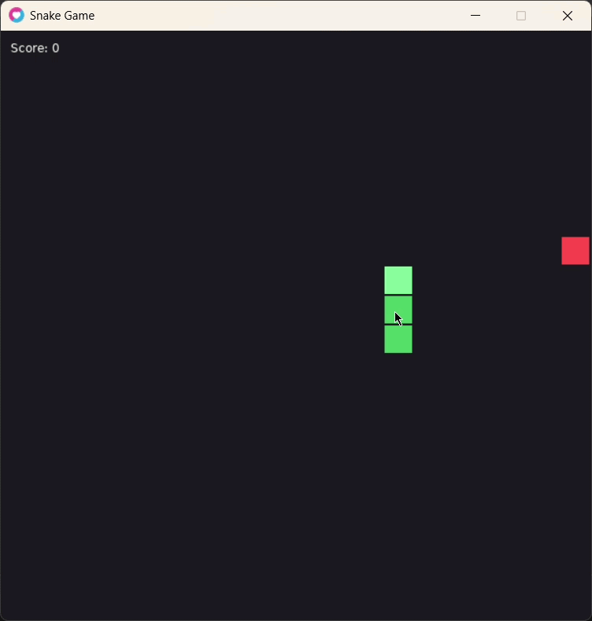
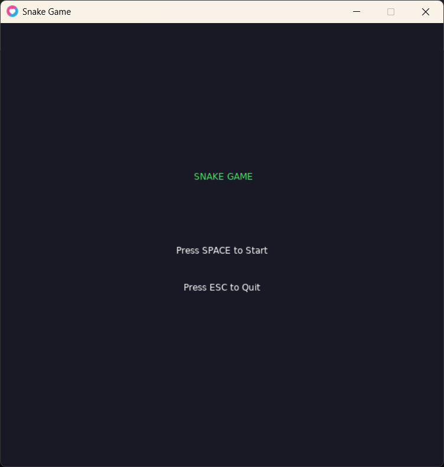
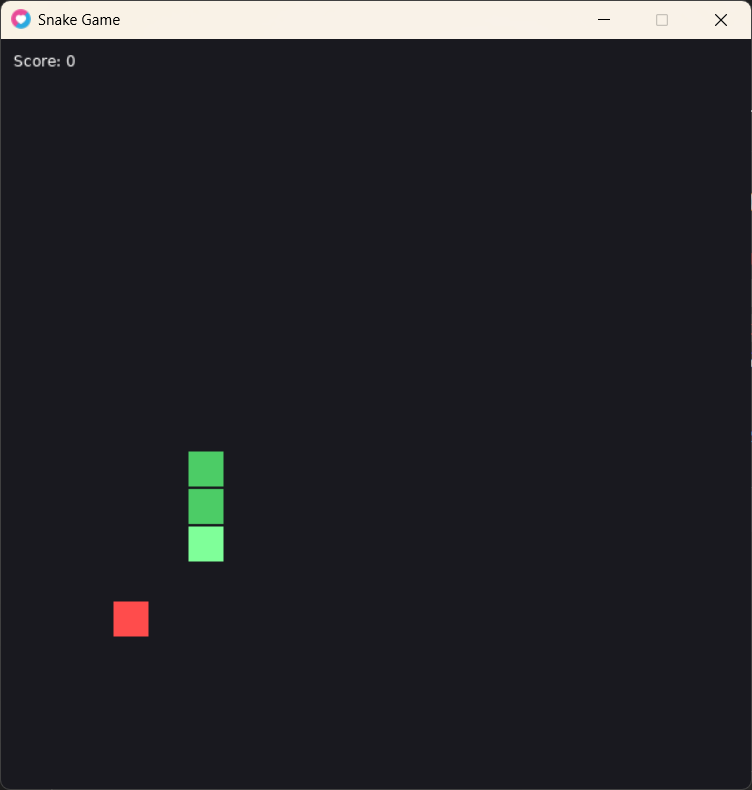
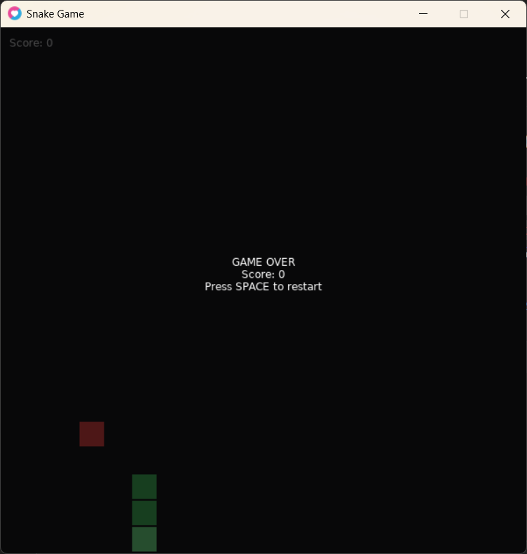

# 🐍 Snake Game - Lua Game Programming Assignment

A modern Snake game built with LÖVE2D and Lua, demonstrating core game programming patterns and modern Lua features.

## 🎮 How to Run

### Prerequisites
- [LÖVE 11.5](https://love2d.org/) installed

### Running the Game
1. Download or clone this repository
2. Open terminal and run:
3. bash
love snake_game/

   Or drag the `snake_game` folder onto `love.exe` (Windows)

### Controls
| Key | Action |
|-----|--------|
| `SPACE` | Start game / Restart after Game Over |
| `↑ ↓ ← →` or `W A S D` | Change direction |
| `ESC` | Return to menu / Quit |

## 📸 Screenshots

### Gameplay Demo


### Main Menu


### Gameplay


### Game Over


## 📁 Project Structure
snake_game/
├── main.lua              # Entry point and main game loop
├── gamestate.lua         # State manager (Menu ↔ Playing)
├── entity.lua            # Entity-Component system
├── vector2.lua           # Vector math utilities with metamethods
├── highscore.lua         # Save/Load system using to-be-closed vars
├── input.lua             # Input handling using Command pattern
├── events.lua            # Event system using Observer pattern (Bonus)
└── states/
    ├── menu_state.lua    # Main menu state
    ├── game_state.lua    # Playing state wrapper
    └── snake_game.lua    # Core game logic and rendering


## 🎯 Design Patterns Used

### 1. State Pattern (`gamestate.lua`)
Manages transitions between Menu and Playing states.

### 2. Entity-Component Pattern (`entity.lua`)
Flexible entity system with Position, Movement, and Renderer components.

### 3. Command Pattern (`input.lua`)
Decouples input handling from game logic via command bindings.

### 4. Observer Pattern (`events.lua`) ⭐ Bonus
Event system for decoupled communication (food eaten, game over).

## ✨ Modern Lua Features

### To-Be-Closed Variables (Lua 5.4)
Used in `highscore.lua` for automatic resource management:

```lua
-- In Lua 5.4:
local file <close> = io.open("highscore.txt", "w")
file:write(tostring(score))
-- File closes automatically, even on error

-- Since LÖVE 11.5 uses Lua 5.1, we simulate with manual close:
local file = io.open("highscore.txt", "w")
file:write(tostring(score))
file:close()

Metamethods (vector2.lua)
Custom operators for Vector2 math:
__add → Vector addition (v1 + v2)
__sub → Vector subtraction (v1 - v2)
__mul → Scalar multiplication (v * 2)
__eq → Equality check (v1 == v2)
__tostring → String representation

📊 Features Checklist
Game starts with menu
Snake moves and changes direction
Food spawns randomly when eaten
Score increases on food consumption
High score saves/loads to file
Vector2 math operations work
Game over on wall/self collision
Event system (Bonus - 2 points)


Assignment Info
Course: AI and Gaming
Assignment: Lua Game Programming - Snake
Student: Karim Tbaileh
Student ID: 12217811
